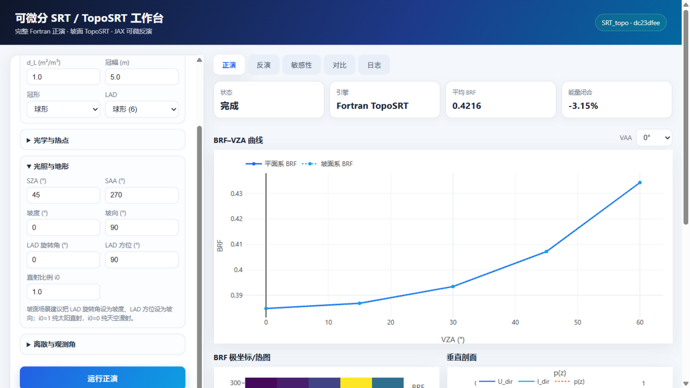
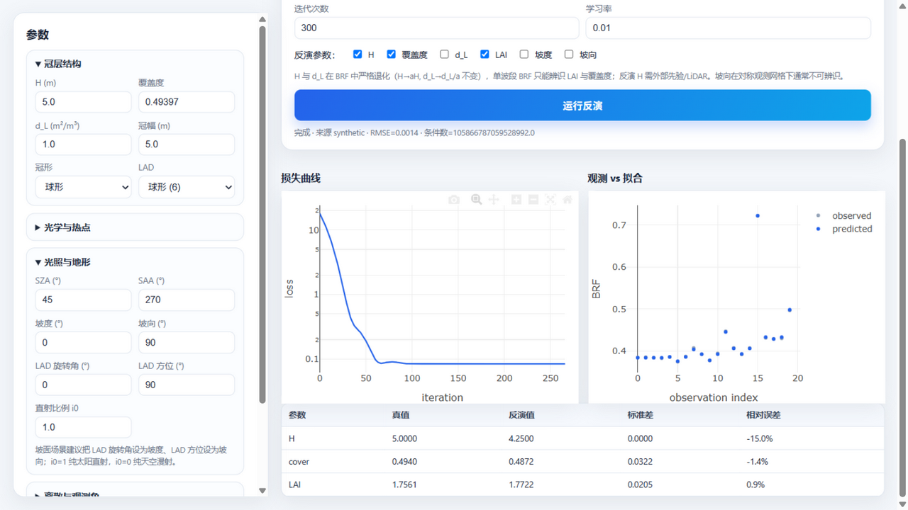
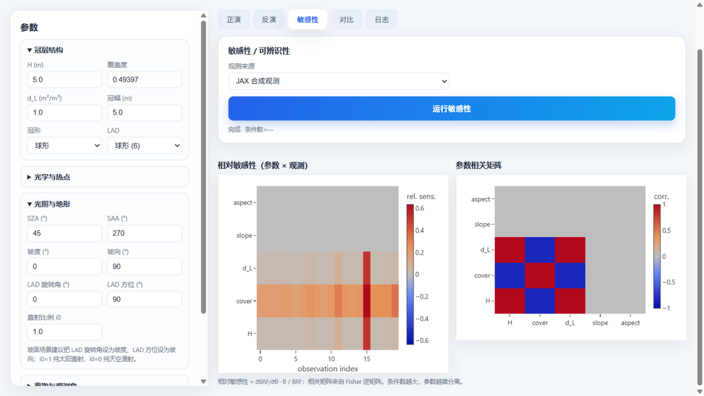

# SRT Workbench · 可微分 SRT / TopoSRT 冠层辐射传输工作台

**在线演示（魔搭 ModelScope 创空间）：** [https://www.modelscope.cn/studios/YuXinpei/srt-workbench](https://www.modelscope.cn/studios/YuXinpei/srt-workbench)
　直连应用：[https://yuxinpei-srt-workbench.ms.show](https://yuxinpei-srt-workbench.ms.show)

> 免费实例空闲后会休眠，首次访问需等 30–60 s 唤醒；首次反演还要 JAX 编译 1–2 min。
> 演示只运行 JAX 引擎（Fortran 参考程序不在公开空间分发）。

A differentiable implementation of the stochastic radiative transfer (SRT / TopoSRT)
model for vegetation canopies, with a local web workbench for forward
simulation, gradient-based inversion and sensitivity analysis. The JAX solver
is validated against the Fortran reference to **~1e-5 in BRF** for spherical,
cylindrical, conical and ellipsoidal crowns, LAD 1–9, and flat/sloping ground.



| 反演 | 敏感性 |
|---|---|
|  |  |

---

## 1. 功能

- **完整 SRT 正演（JAX，可微）**
  - 冠形：球 / 柱 / 锥 / 椭球（TreeType 1–4）
  - 叶倾角分布：LAD 1–9（含 `get_G` / `get_APF` 数值积分）
  - 地形：平坦 + 坡面（slope/aspect、LAD 旋转角/方位）
  - 光照：纯直射 / 纯漫射 / 混合（`i0`）
  - 多波段光学（每波段 ρ_L/τ_L/土壤反射率）
- **梯度反演**（optax/Adam）：LAI、覆盖度、H、d_L；可选高斯先验
- **敏感性/可辨识性**：Jacobian、Fisher、相关矩阵、条件数
- **对比**：Fortran 与 JAX 曲线叠加 + RMSE（本地 Fortran 可用时）
- **本地 Web 界面**：参数输入、BRF 曲线/热图/剖面、能量收支、CSV/JSON 下载

## 2. 验证

与 Fortran TopoSRT 的 BRF 对比（slope15, aspect 0，除注明外）：

| 案例 | max abs diff | RMSE |
|---|---:|---:|
| 平坦球冠（golden） | 6.7e-6 | 3.7e-6 |
| slope15 / 30 / 45（球冠） | 5e-6 – 1.0e-5 | 2.8e-6 – 3.9e-6 |
| slope15, aspect 180 / 270 | 6.8e-6 / 1.1e-5 | 4.3e-6 / 5.6e-6 |
| 850 nm, slope15, aspect270（26 角） | 9.4e-6 | 5.4e-6 |
| 柱冠 平坦 / slope15 | 9.6e-6 / 8.5e-6 | — |
| 锥冠 / 椭球冠 | 1.0e-5 / 1.2e-5 | 4.1e-6 / 5.1e-6 |
| 球冠 + LAD1 / LAD8 | 7.1e-6 / 9.5e-6 | 4.2e-6 / 4.1e-6 |

细节与逐量诊断见 [`docs/VALIDATION.md`](docs/VALIDATION.md)。

## 3. 快速开始

```bash
python -m venv .venv
# Windows: .venv\Scripts\activate   |   Linux/macOS: source .venv/bin/activate
pip install -r requirements.txt

python launcher.py            # 打开浏览器界面
# 或者无界面：
python launcher.py --headless --port 5057
```

浏览器打开 `http://127.0.0.1:5057/`。

> Fortran 引擎是可选的：默认的 JAX 模型即可完成正演/反演/敏感性。
> 如需 Fortran 对比，把 `SRT_topo/exe_SRT_topo_static.exe` 放到仓库外并设置
> `SRT_FORTRAN_EXE=<path>`（Windows），或把编译产物放到 `SRT_topo/` 下。

## 4. Docker

```bash
docker build -t srt-workbench .
docker run -p 7860:7860 srt-workbench
# http://127.0.0.1:7860/
```

容器默认是公开演示模式：JAX 引擎、无 Fortran、`nz ≤ 20`、`n_iter ≤ 300`、
单并发、按 IP 限流。

## 5. 部署到 Hugging Face Spaces

见 [`docs/DEPLOY.md`](docs/DEPLOY.md)。简述：

1. 创建 Docker Space（免费 CPU 即可，16 GB 内存足够）；
2. 把本仓库推送到 Space 的 git 地址（Space 根目录的 README 需带
   `sdk: docker` / `app_port: 7860` 元数据，模板在 `deploy/hf/README.md`）；
3. 等待构建，访问 `https://<user>-<space>.hf.space`；
4. 把链接填到本 README 顶部。

## 6. 环境变量

| 变量 | 默认 | 说明 |
|---|---|---|
| `SRT_DEMO` | `0` | `1` 时使用临时运行目录、单并发 |
| `SRT_ALLOW_FORTRAN` | `1` | `0` 关闭 Fortran 引擎（公开演示默认关闭） |
| `SRT_FORTRAN_EXE` | — | Fortran 可执行文件路径 |
| `SRT_MAX_NZ` | `0` | 最大 nz（0=不限制） |
| `SRT_MAX_ITER` | `0` | 反演最大迭代数（0=不限制） |
| `SRT_MAX_WORKERS` | `2`（demo `1`） | 并发任务数 |
| `SRT_RATE_LIMIT` / `SRT_RATE_WINDOW` | `0` / `600` | 每 IP 每窗口的任务提交上限（0=关闭） |
| `SRT_RUNS_DIR` | `runs/` | 任务输出目录 |
| `SRT_JAX_CACHE` | 临时目录 | XLA 持久编译缓存目录 |
| `HOST` / `PORT` | `127.0.0.1` / `0` | 服务监听地址/端口 |

## 7. API

| 方法 | 路径 | 说明 |
|---|---|---|
| GET | `/api/health` | 引擎状态（`fortran` 是否可用） |
| POST | `/api/forward` | Fortran 正演（需 Fortran 可用） |
| POST | `/api/jax/forward` | JAX 正演 |
| POST | `/api/inversion` | 梯度反演 |
| POST | `/api/sensitivity` | Jacobian/Fisher |
| GET | `/api/jobs/<id>` | 任务状态/日志 |
| GET | `/api/jobs/<id>/result` | 结果 JSON |
| GET | `/api/download/<id>/<file>` | 下载 `brf.csv` / `jax_brf.csv` / `result.json` |

## 8. 测试

```bash
pip install -r requirements-dev.txt
pytest tests -q                    # 快速测试
SRT_SLOW_TESTS=1 pytest tests -q   # 含梯度/反演/缓存测试（较慢）
```

## 9. 可辨识性与适用边界

- **H 与 d_L 存在精确尺度不变性**：`H → aH, d_L → d_L/a`（cover 不变）时 BRF
  严格不变。因此单波段 BRF 只能辨识 **LAI = d_L·H·Λ(cover)** 与 **cover**；
  反演 H 需要外部先验（如 LiDAR 树高）。本项目提供 `LAI` 参数化与高斯先验。
- 本模型是**一维统计辐射传输**（空间一维、角度二维）。树冠的三维几何通过
  `p(z)` 与成对相关核 `K(z1,z2,Ω)` 统计进入，但没有 x–y 分辨率、单棵树位置和
  树影。与三维显式模型（如 LESS）相比，绝对量级可以接近，但角向对比
  （垂直主平面变暗、热点增强）会存在结构差异；真实数据反演需先做偏差标定。

## 10. 许可证与致谢

- 本仓库代码：MIT（见 [`LICENSE`](LICENSE)）。
- 模型来源：SRT / TopoSRT（Yan Kai 等）的 Fortran 参考实现未包含在本仓库；
  `diff_srt/ref_srt.py` 是逐行对照的 NumPy 复现，`diff_srt/jax_srt.py` 是可微 JAX 版本。
- 如果使用本工作台，请引用原 SRT/TopoSRT 论文并注明本仓库。
